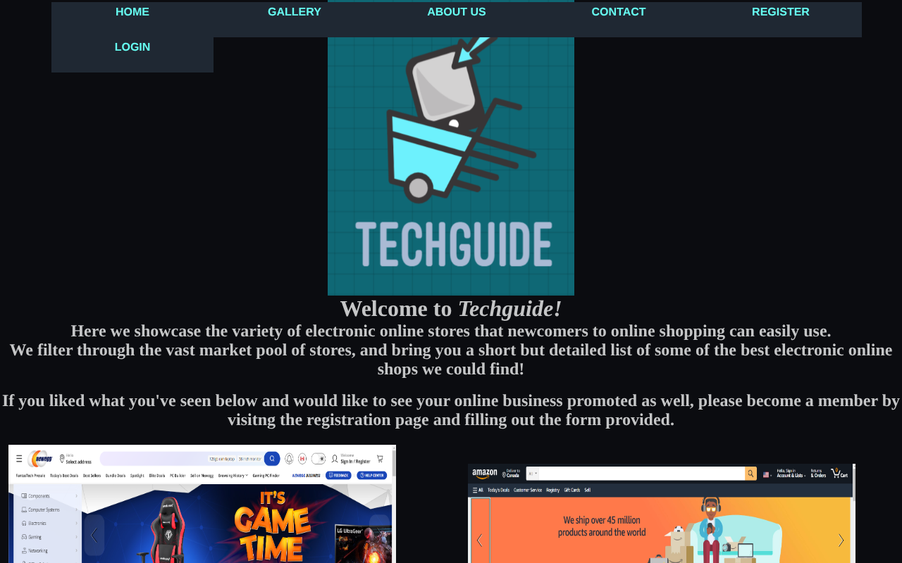
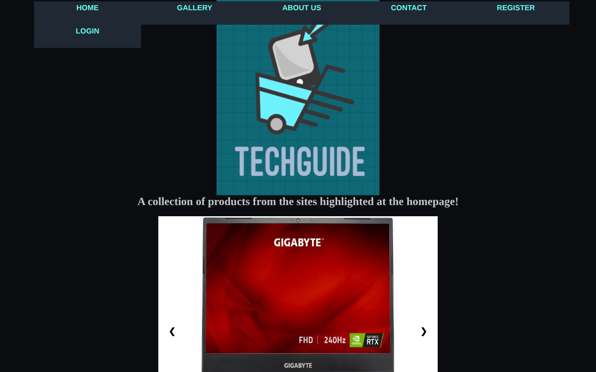

# TechGuide — Group Website Project

A multi-page website that helps people new to online shopping find trustworthy electronics retailers. It came out of the shift to online shopping during the pandemic and highlights well-known stores to help newcomers avoid scams. Businesses can also register to have their own store promoted.

## My role

This was a three-person group project. **I created the site's content and the front-end structure: all the pages in HTML and CSS.** My teammates handled the JavaScript (including the gallery slideshow) and a PHP/MySQL back end, which is not included in this repository.

## Pages

| Page | Contents |
|---|---|
| Home | Store spotlights with screenshots and short reviews of each retailer |
| Gallery | A slideshow of featured products from those stores |
| About Us | The site's purpose and the team's roles |
| Contact | A contact form |
| Register | A sign-up form for businesses, with field types such as email, tel and checkboxes, and `required` validation |
| Login | A login form |

## Running it

Open `index.html` in a browser. No build step or server is needed.

The forms submit to static confirmation pages, because the back end isn't part of this repository.

Store names, logos and product images belong to their respective owners and are used here only to illustrate the reviews.
